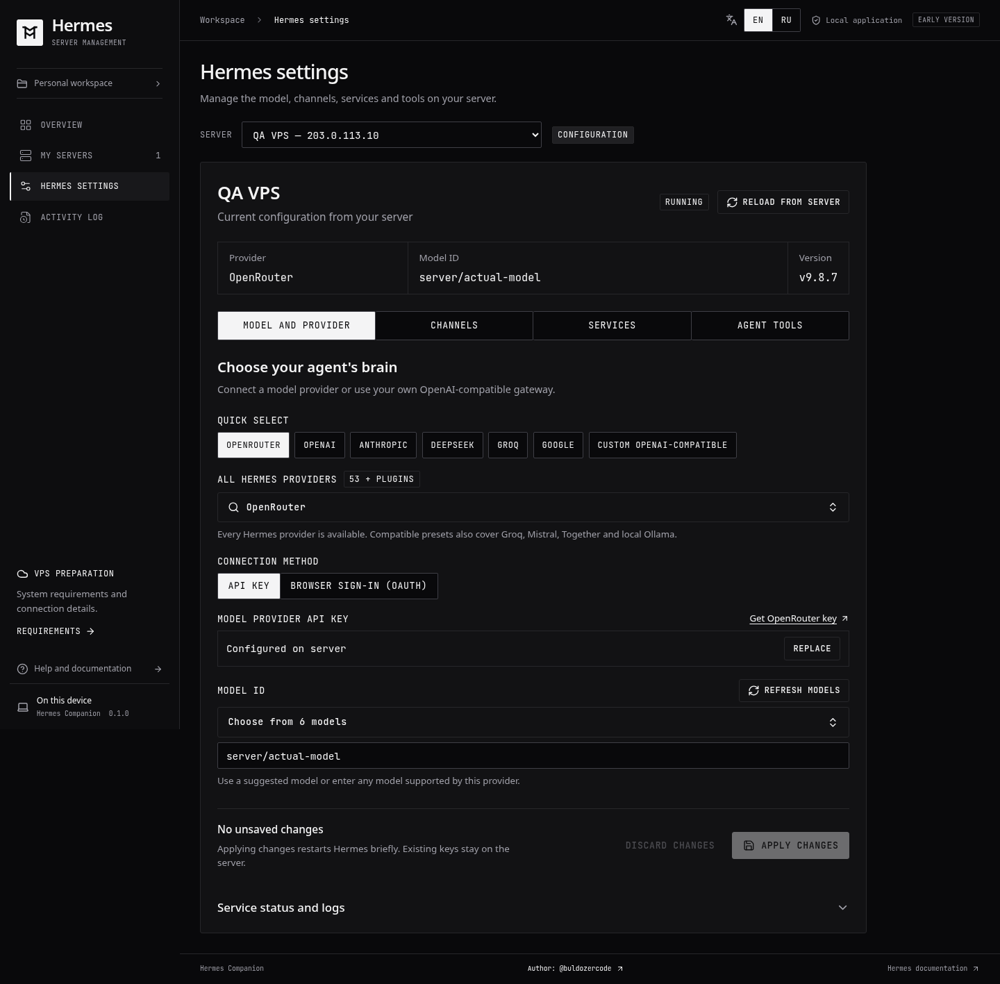

# Hermes Companion

**Установите Hermes Agent на свой сервер через пошаговый графический интерфейс.**

[English](README.md) · Русский

Hermes Companion проводит от выбора VPS до подключения модели и Telegram-бота. Приложение выполняет удалённую установку, а затем позволяет менять провайдеров, управлять инструментами и сервисами и читать логи. Агент работает на вашем сервере.

Это независимое приложение для [Hermes Agent от Nous Research](https://github.com/NousResearch/hermes-agent), написанное на Rust, Tauri и React.



## С чего начать

Проект находится на стадии **раннего тестирования**. Откройте раздел **Releases** этого репозитория, выберите версию и скачайте установщик для своей ОС из списка **Assets**. Для готовой сборки устанавливать Rust или Node.js не требуется.

| Система компьютера  | Файл                   | Установка                                                         |
| ------------------- | ---------------------- | ----------------------------------------------------------------- |
| Windows x86_64      | `_setup.exe`           | Запустите установщик, затем откройте Hermes Companion             |
| macOS Apple Silicon | ARM64 `.dmg`           | Откройте DMG и перенесите приложение в Applications               |
| macOS Intel         | x86_64 `.dmg`          | Откройте DMG и перенесите приложение в Applications               |
| Linux x86_64        | `.AppImage` или `.deb` | Разрешите выполнение AppImage и запустите его либо установите DEB |

Проверенные платформы и известные ограничения указаны в описании релиза. Если у выбранной версии нет установщика для вашей платформы, можно [запустить приложение из исходников](#запуск-из-исходников). Форматы пакетов и порядок сборки и публикации описаны в [руководстве по релизам](docs/releases.md).

Это приложения для компьютера. Браузерный предпросмотр позволяет изучить интерфейс; настоящее подключение по SSH и установка доступны в desktop-приложении. Удалённый установщик сейчас поддерживает **Ubuntu 24.04 LTS с systemd**.

## Что понадобится

- Чистый VPS с Ubuntu 24.04 LTS и доступом по SSH. Рекомендуется **2 vCPU, 4 ГБ RAM и диск 25 ГБ**. Для более слабого сервера приложение покажет рекомендации; при свободном месте меньше 1 ГБ установка блокируется.
- Вход под root либо пользователь с `sudo` без пароля для подготовки сервера.
- API-ключ или аккаунт поддерживаемого провайдера при подключении модели. Можно сначала установить Hermes, а модель подключить позже; вход через браузер выполняется после установки.
- Токен Telegram-бота и ваш числовой Telegram ID, если нужен Telegram. В приложении есть ссылки и подсказки для их получения.

Встроены ссылки на [VDSina](https://www.vdsina.com/?partner=62n73usqa1jp) и [HIP Hosting](https://hip.hosting/?code=9f78107d10447a5f9b47). Подойдёт и ваш существующий сервер, соответствующий требованиям. Аренда VPS и платные сервисы оплачиваются их провайдерам отдельно.

## От сервера до агента

1. **Добавьте сервер.** Следуйте подсказкам по покупке или выберите, что сервер уже есть.
2. **Подключитесь.** Введите данные SSH и проверьте отпечаток ключа сервера перед передачей учётных данных.
3. **Выберите настройки.** Подключите Telegram и нужные сервисы голоса, поиска и изображений. Модель можно подключить сразу или после установки; при отложенной настройке ключ модели не нужен. Основные инструменты агента включены по умолчанию.
4. **Установите Hermes.** Следите за прогрессом подготовки Ubuntu, создания пользователя `hermes` и установки последнего стабильного релиза. Удалённая задача продолжит работу после закрытия приложения.
5. **Управляйте агентом.** Меняйте модели и провайдеров, заменяйте ключи, настраивайте каналы и инструменты, смотрите состояние службы и логи. Для применения настроек переустанавливать Hermes не требуется.

## Подключения и возможности

| Раздел         | Что доступно сейчас                                                                                                                                |
| -------------- | -------------------------------------------------------------------------------------------------------------------------------------------------- |
| Модели         | Все 53 штатных варианта провайдеров из каталога; свои OpenAI-совместимые шлюзы; пресеты Groq/Mistral/Together/Ollama                               |
| Вход в аккаунт | Браузерные сценарии ChatGPT, Anthropic, OpenRouter, Nous, MiniMax и xAI; Google Antigravity через плагин сообщества Hermes и официальный `agy CLI` |
| Выбор модели   | Автоматическая загрузка каталога после ввода ключа или авторизации, поиск, обновление списка и ручной ввод ID                                      |
| Каналы         | Пошаговое подключение Telegram и расширенный каталог каналов Hermes, включая Discord и Slack                                                       |
| Инструменты    | Терминал, код, файлы, память и веб включены по умолчанию; ненужное можно отключить                                                                 |
| Сервисы        | Озвучка, распознавание речи, поиск, чтение страниц и необязательная генерация изображений, включая бесплатные варианты без ключей                  |
| Управление     | Возобновляемое отображение прогресса установки, запуск/остановка/перезапуск службы, логи и отдельные разделы настроек                              |
| Интерфейс      | Плотный монохромный интерфейс с сохранением выбора EN/RU; технические ошибки и логи всегда на английском                                           |

Подсказки провайдеров соответствуют снимку каталога и не фиксируют версию устанавливаемого Hermes. Некоторым подключениям нужны дополнительные ключи, доступ к аккаунту или зависимости. Список моделей не подтверждает квоту и возможность генерации. Для Antigravity используются [плагин сообщества](https://github.com/neerazz/hermes-antigravity-oauth) и [официальный CLI Google](https://antigravity.google/cli); стандартный вход включает небольшой проверочный запрос после подтверждения доступа.

## Данные и доступ

Профили серверов, доверенные отпечатки SSH и настройки без секретов хранятся локально в SQLite. Пароли SSH и приватные ключи используются для подключения и не записываются в эту базу. Ключи провайдеров остаются в приватных файлах или штатных хранилищах аккаунтов на VPS; интерфейс получает признак наличия ключа, а не его значение.

Hermes работает от отдельного пользователя без root и sudo. Инструменты терминала и файлов позволяют изменять файлы, доступные этому пользователю. Управляемый API слушает loopback и требует авторизации. Удаление профиля из Companion не удаляет Hermes с сервера.

Установщик защищает существующие установки Hermes, которыми приложение не управляет. Для первой установки используйте чистый сервер. Рабочая служба сама по себе не подтверждает, что выбранная модель отвечает.

## Запуск из исходников

Установите **Node.js 22.12+**, стабильный Rust и [зависимости Tauri для вашей ОС](https://v2.tauri.app/start/prerequisites/). Затем выполните в каталоге проекта:

```bash
npm ci
npm run desktop
```

Откроется нативное приложение и запустится локальный frontend для разработки. Для обычного использования `.env` не нужен: данные сервера вводятся в приложении. Перед запуском закройте другой предпросмотр, занимающий порт 1420.

Чтобы собрать release-установщик на текущей ОС:

```bash
npm run release
```

Установщики и контрольные суммы SHA-256 появятся в `releases/<platform>/`. Тестовые macOS-сборки используют ad-hoc-подпись; Windows-сборки выпускаются без подписи издателя. Подготовка систем и установка описаны в [руководстве по релизам](docs/releases.md).

## Состояние проекта и документация

Сборки создаются в GitHub Actions и прикрепляются к релизам после успешного выполнения workflow. Статус проверки каждой версии указан в её описании. Обновление кода Hermes из приложения, подписанная публичная дистрибуция и автоматическое обновление приложения остаются в планах.

- [Разработка, тестирование и локальные данные](docs/development.md)
- [Сборки и чеклист проверки на разных ОС](docs/releases.md)
- [Архитектура и план развития](docs/architecture.md)
- [Дизайн интерфейса](docs/design.md)

Автор — [@buldozercode](https://t.me/buldozercode).
